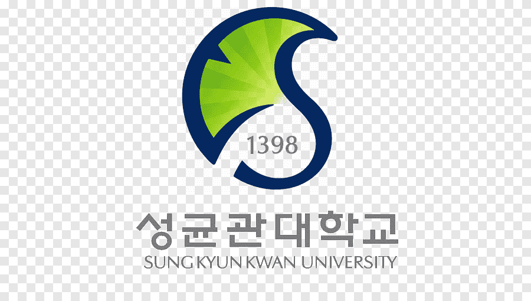

  

# Junsup Kim

## Education

**Sungkyunkwan University**, Seoul, Korea  
B.S. Candidate in Mathematics and Economics  
Mar. 2021 - Present  

## Research Interests

- Sequential decision making
- Bandit algorithms
- Statistical machine learning

## Research Experience

**Research Intern, Statistical Decision-Making Lab**  
KAIST, Daejeon, Korea  
Advisor: Prof. Hoseung Song  
Jun. 2026 - Aug. 2026

**Undergraduate Researcher, AI & Media Lab (AIM Lab)** 
Sungkyunkwan University, Seoul, Korea 
Advisor: Prof. Sungeun Hong 
Mar. 2026 - Jun. 2026
